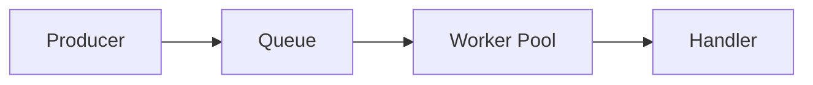
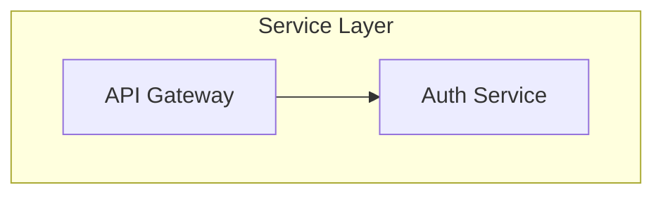
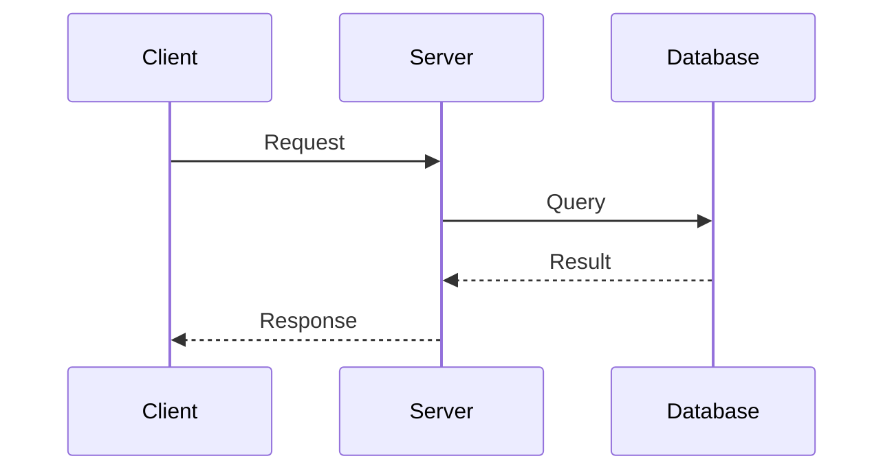
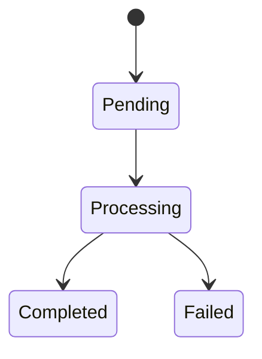

# Write Technical Blog Post

Create a crisp, practical technical blog post explaining this project to a technical audience.

**Mindset:** Share real decisions, not marketing. Use `/pb-preamble` thinking (honesty, transparency) and `/pb-design-rules` thinking (especially Clarity: explain your reasoning, not just your conclusions).

Explain the problems you solved, the trade-offs you made, what you'd do differently. Honest technical writing builds trust.

**Resource Hint:** sonnet - blog post writing follows a structured outline with code examples and diagrams

---

## When to Use

- Announcing a new project or major release
- Sharing design decisions and architecture with the community
- Creating content for the project's documentation site

---

## Role

Write as a seasoned technical architect sharing real-world experience - clear, confident, and grounded.

---

## Tone & Style

**Do:**
- Natural, human voice
- Professional and concise
- First-person plural ("we") or neutral tone
- Explain concepts clearly without fluff
- Short, purposeful sentences

**Don't:**
- Marketing buzzwords or hype
- AI-sounding phrases or patterns
- Emojis or exclamation marks
- Overly casual or overly formal
- Exaggerated claims

---

## Structure

### 1. Title
Descriptive and straightforward. Not clickbait.

```markdown
# Building a High-Performance Job Queue in Go
```

### 2. Introduction
- What the project does
- Why it exists
- What problem it solves
- Who it's for

### 3. Rationale
- Motivation behind the design
- Why existing solutions weren't sufficient
- Key constraints or requirements

### 4. Architecture Overview
Include a **Mermaid diagram** showing:
- Core components
- Data flow
- Key interactions

````markdown

````

### 5. Usage Examples
Clear code snippets showing:
- Basic setup
- Common patterns
- Configuration options

### 6. Key Design Decisions
Explain important trade-offs:
- What was chosen and why
- What was explicitly avoided
- Lessons learned

### 7. Real-World Applications
- Where it fits in typical architectures
- Example use cases
- Integration patterns

### 8. Conclusion
- When to use it
- When not to use it
- Potential extensions or future work

---

## Formatting

- Markdown throughout
- Syntax-highlighted code blocks
- Proper section headers (`##`, `###`)
- One or more Mermaid diagrams
- Tables for comparisons

---

## Output

Save as: `docs/TECHNICAL_BLOG.md`

Ready for direct publication or review.

---

## Mermaid Diagram Types

**Architecture:**


**Sequence:**


**State:**


---

## Related Commands

- `/pb-repo-readme` - Generate comprehensive README
- `/pb-documentation` - Technical documentation guidance
- `/pb-repo-enhance` - Full repository enhancement suite

---

*Technical depth, practical focus.*
